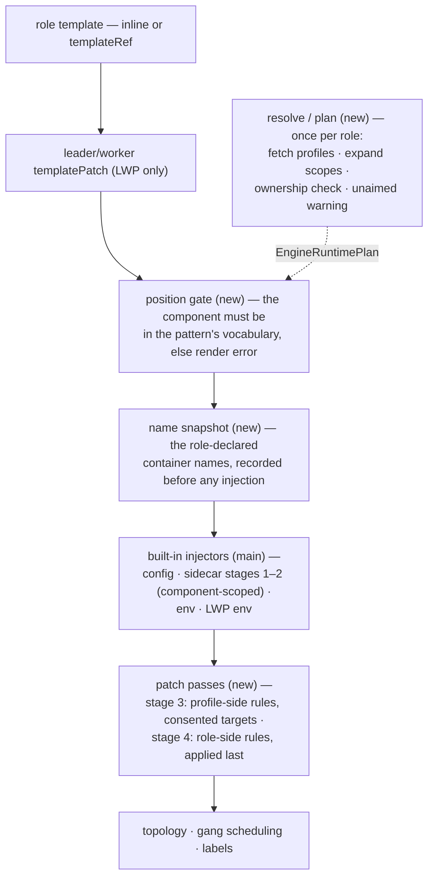

# KEP-531: Engine Runtime Profile Injection

<!-- toc -->
- [KEP-531: Engine Runtime Profile Injection](#kep-531-engine-runtime-profile-injection)
  - [Summary](#summary)
  - [Motivation](#motivation)
  - [Goals](#goals)
  - [Non-Goals](#non-goals)
  - [Proposal](#proposal)
    - [Overview](#overview)
    - [Design Decisions](#design-decisions)
  - [Design Details](#design-details)
    - [Effective Component Set](#effective-component-set)
    - [Scope Ownership](#scope-ownership)
    - [Per-Dimension Gates](#per-dimension-gates)
    - [Consent and Trust](#consent-and-trust)
    - [Duplicate Delivery](#duplicate-delivery)
    - [Role-Side Patches](#role-side-patches)
    - [Patch Grammar](#patch-grammar)
    - [Application Order](#application-order)
    - [Render Pipeline](#render-pipeline)
    - [Validation Layer Split](#validation-layer-split)
  - [Compatibility Guarantees](#compatibility-guarantees)
  - [Risks and Mitigations](#risks-and-mitigations)
  - [Test Plan](#test-plan)
  - [Alternatives Considered](#alternatives-considered)
  - [Future Work](#future-work)
  - [Milestones](#milestones)
<!-- /toc -->

## Summary

Extend ClusterEngineRuntimeProfile (CERP) with `containerPatches` — a
list of RFC 6902 JSONPatch `add` operations, addressed by
container-relative RFC 6901 paths, each firing at the addresses the
referencing role consents to — and complete the reference-side
selection so a Role states, per `engineRuntimes` reference, where a
referenced profile applies:

- `component` (optional) names the **one** component of the role's
  pattern that the reference operates on — the rendered workload's
  `leader`/`worker`, or one of the pattern's declared component names.
  Absent, the reference keeps main's compatible behavior: each pattern
  applies its own default injection scope — the leader only under
  leaderWorkerPattern (main skips sidecar injection for the worker
  template), every declared component under customComponentsPattern,
  the single implicit component under standalonePattern.
- `patchContainers` (optional) lists **bare container names** — the
  role-declared containers of the named component that consent to the
  profile's `containerPatches` rules. The list gates the profile's
  rules only; it never addresses the role's own rules.
- `containerPatches` on the reference (optional) carries the **role's**
  RFC 6902 patch rules, each entry naming its own target container —
  role-declared or profile-declared — within the reference's
  component. Role-declared targets keep every profile-coupled
  modification inside the reference: removing it leaves no residue in
  the role template.

The allowed patch paths cover the four influence avenues on a Linux
process — its filesystem (volume mounts), its environment, its argv,
and its privileges (Linux capabilities) — expressed in a vocabulary any
JSON tooling already understands. The result is a generic injection
mechanism: rbg provides a capability set, and plugins fit it. An
acceleration package (custom plugin for SGLang/vLLM), a telemetry
interposition library, or a C++ hook package plugs in by publishing a
profile — with rbg retaining zero knowledge of the plugin's internals
and the workload author contributing nothing beyond their own container
names.

## Motivation

The immediate driver is the plugin ecosystem growing around the
community inference engines. SGLang and vLLM are consumed today as
engine containers inside a larger rendered workload; the surrounding
ecosystem — acceleration packages, interposition libraries, kernel/data
accelerators — needs to place its artifacts into those workloads. The
operator publishing the plugin cannot write the workload, and the user
writing the workload does not know the plugin's internals. A
ClusterEngineRuntimeProfile is the meeting point: the plugin publisher
writes one profile, any RoleBasedGroup author references it by name.

Issue [#531](https://github.com/sgl-project/rbg/issues/531) inventories
the defects of the existing injection that this KEP answers:

1. **Pod-level injection is uncontrolled.** Referencing a profile means
   its init containers, sidecars and volumes land wherever the pattern
   happens to inject them — the leader template under
   leaderWorkerPattern, every declared component under
   customComponentsPattern — and a role cannot say "this runtime
   belongs to the worker component," for which main offers no path at
   all.
2. **The profile has no way to touch role-declared containers.** A
   profile author cannot add an env var or a volumeMount to the role's
   own engine container — the second delivery dimension of a profile
   does not exist.
3. **Role customization of profile containers is env/args-only**,
   expressed as full `corev1.Container` objects whose extra fields are
   silently ignored — an imprecise grammar for what is really a patch.
4. **The dormant `injectContainers []string`** predates any semantics;
   its shape cannot express the consent model this KEP needs.

Two motivations anchor the decisions below:

- **The reference is a toggle.** Everything profile-coupled — injected
  containers, legacy overrides, the role's own patches — is expressed
  through the `engineRuntimes` entry, so removing the entry removes it
  all and leaves no stray environment variables in the role template.
- **One-way content flow.** Only the role consumes the profile's
  content; the profile never consumes the role's. The workload author
  configures the publisher's code (env, args, command); the publisher
  delivers resources into consented role containers, never the other
  way around.

## Goals

- A role can scope one `engineRuntimes` reference to a single component
  of its pattern, with the absent-field default byte-identical to main.
- A profile can patch role-declared containers (env, args, command,
  volume mounts, Linux capabilities) at consented targets, using
  RFC 6902 `add` operations with container-relative RFC 6901 paths.
- A role can patch any container of the component — its own or the
  profile's — with the same rule format: one grammar, every
  role-authored modification expressed in the reference.
- The reference is a self-contained toggle: removal takes every
  modification it carried with it, leaving no residue in the role
  template.
- The legacy `containers` env/args merge keeps working unchanged,
  within the reference's component scope.
- Pre-existing objects render byte-for-byte identically to main.
- Validation is split: CEL at write time checks shape only;
  vocabularies and existence are decided at render time.

## Non-Goals

- A component opt-out of pod-level injection: deliberate non-injection
  remains inexpressible, exactly as on main.
- Multi-container targeting per reference: one reference names at most
  one component; multiple components are expressed as multiple
  references with the same `profileName`.
- Attaching semantics to `injectContainers`: it stays optional and
  inert, exactly as published on main, and is removed at the next API
  version boundary.
- `replace`/`remove`/`test` patch operations: the grammar is `add`-only.
- Mutating the injected pod-level content (initContainers, sidecars,
  volumes) via
  the patch grammar — patches address containers only.
- Any pod-spec mutation of role templates: resources, probes, ports,
  `hostIPC`, `shareProcessNamespace`,
  `terminationGracePeriodSeconds`, `imagePullSecrets`, sysctls,
  `runtimeClassName` and kin stay with the role template author. A
  profile delivers containers, init containers and volumes; a `/dev/shm`
  enlargement is expressible today (an emptyDir `medium: Memory`
  volume plus a mount patch), but the pod-level fields themselves are
  out of reach from either side.
- Tuning a profile-injected container beyond the four patch avenues
  (its resources, `envFrom`, probes): the profile author sizes them;
  the consuming role's remedy is a republished profile, not a patch.
- Layering semantics — profile rules applying after the role's rules
  (env `$(VAR)` references to role-appended entries, argv positioned
  after role-inserted elements). Role patches land last — what the role
  writes lands where it is written — so the profile cannot claim
  positions ahead of role content; a profile whose command wrap must be
  outermost relies on the role author not prepending into a consented
  container, with a render-time event when positional shadowing occurs.
  The reserved `replace` op and any ordering change are the future seam.

## Proposal

### Overview

A ClusterEngineRuntimeProfile declares pod-level content — init
containers, sidecars and volumes — and, new, per-container patch rules.
A role's `engineRuntimes` entry references a
profile by `profileName` and, optionally, narrows the reference to one
`component`, consents to the profile's patch rules, and contributes
patch rules of its own:

```yaml
apiVersion: workloads.sgl-projects.io/v1alpha2
kind: RoleBasedGroup
spec:
  roles:
  - name: lg
    # ... other role fields omitted
    leaderWorkerPattern:
      template:
        spec:
          containers:
          - name: w
            image: w
    engineRuntimes:
    - profileName: vllm-runtime        # required; render-time resolution
      component: worker               # optional; absent = the pattern's default components
      patchContainers: [w]            # optional; consent for the profile's patches
      containerPatches:               # optional; role-side: the role's patches, any container of the component
      - container: runtime-sidecar    # profile-declared target — configures the publisher's container
        jsonPatch: {op: add, path: /env/-, value: {name: FOO, value: bar}}
      - container: w                  # role-declared target — coupled to this reference, removed with it
        jsonPatch: {op: add, path: /env/-, value: {name: TELEMETRY_ENDPOINT, value: 'sidecar:9090'}}
      containers:                     # legacy; unchanged
      - name: runtime-sidecar
        args: [--extra]
```

```yaml
apiVersion: workloads.sgl-projects.io/v1alpha2
kind: ClusterEngineRuntimeProfile
metadata: {name: vllm-runtime}
spec:
  containers:
  - name: runtime-sidecar
    image: vllm/runtime:latest
  volumes: [...]
  containerPatches:                   # profile-side: target-less rules, each firing at every consented patchContainers address
  - jsonPatch: {op: add, path: /env/-, value: {name: NCCL_DEBUG, value: INFO}}
```

Go shape (reference side):

```go
type EngineRuntime struct {
	// +kubebuilder:validation:MinLength=1
	ProfileName string `json:"profileName"`

	// +optional
	// +kubebuilder:validation:MinLength=1
	// +kubebuilder:validation:MaxLength=63
	// +kubebuilder:validation:Pattern=`^[a-z0-9]([-a-z0-9]*[a-z0-9])?$`
	Component string `json:"component,omitempty"`

	// +optional
	// +kubebuilder:validation:MinItems=1
	// +kubebuilder:validation:MaxItems=32
	// +kubebuilder:validation:items:MaxLength=63
	// +kubebuilder:validation:XValidation:rule="self.all(p, p.matches('^[a-z0-9]([-a-z0-9]*[a-z0-9])?$'))",message="container names must be DNS labels"
	PatchContainers []string `json:"patchContainers,omitempty"`

	// +optional
	// +kubebuilder:validation:MinItems=1
	// +kubebuilder:validation:MaxItems=32
	// +kubebuilder:validation:XValidation:rule="self.all(p, has(p.jsonPatch))",message="exactly one patch field must be set"
	// +listType=atomic
	ContainerPatches []EngineRuntimeContainerPatch `json:"containerPatches,omitempty"`

	// +optional
	Containers []corev1.Container `json:"containers,omitempty"`

	// Retained exactly as published on main: optional and inert. No
	// semantics are attached; removed at the next API version boundary.
	//
	// +optional
	InjectContainers []string `json:"injectContainers,omitempty"`
}
```

```go
// One rule, enforced by CEL:
// +kubebuilder:validation:XValidation:rule="has(self.jsonPatch)",message="exactly one patch field must be set"
type EngineRuntimeContainerPatch struct {
	// +kubebuilder:validation:MinLength=1
	// +kubebuilder:validation:MaxLength=63
	// +kubebuilder:validation:Pattern=`^[a-z0-9]([-a-z0-9]*[a-z0-9])?$`
	// +kubebuilder:validation:Required
	Container string `json:"container"`

	// +optional
	JSONPatch *ContainerJSONPatch `json:"jsonPatch,omitempty"`
}
```

The profile side speaks the same RFC 6902 rule format with a different
addressing model: `spec.containerPatches []ContainerPatch` entries are
**target-less** — each entry is `{jsonPatch}` and fires at every
consented `patchContainers` address of the referencing component; the
consent list does the addressing. The split follows the knowledge
asymmetry: the role author knows container names (the template is
theirs), so reference entries name their targets; a cluster-scoped
publisher cannot know consumer container names, so the consent list is
the only addressing available to that side. A oneOf wrapper leaves
room for future patch formats without touching `jsonPatch`.

### Design Decisions

| # | Decision | Rationale |
|---|----------|-----------|
| D1 | One reference names **at most one** component. Multiple components are expressed as multiple references with the same `profileName`. | One reference = one scope keeps every rule local; bare container names need no qualified `component/container` form. |
| D2 | Absent `component` = the pattern's **default component set** (main's published behavior; it differs per pattern — leader-only under leaderWorkerPattern). | Byte-for-byte compatibility for pre-existing references; the default expansion is the compatibility mechanism. |
| D3 | Fresh field naming: `component`, `patchContainers`, `containerPatches`. `injectContainers` stays exactly as main published it: optional, inert, unread — removed at the next API version boundary. | The field never had semantics, so accepting it changes nothing. Rejecting non-empty values would tighten validation inside the already-published v1alpha2, the larger incompatibility. |
| D4 | The patch grammar is **shared**, not symmetric in shape: both sides speak the same RFC 6902 add-only rule format, but a reference-side entry names its target container — any container of the component — while a profile-side entry is target-less and fires at every consented address — the consent list does the addressing. The addressing models follow the knowledge asymmetry: the role knows container names, the cluster-scoped publisher cannot. | One grammar, two addressing models; the legacy `containers` append mechanism is retained for compatibility as the surface `containerPatches` enhances and eventually supersedes. |
| D5 | Deliberate non-injection of the profile's pod-level content remains **inexpressible**, exactly as on main. | Not a regression; an explicit opt-in can be added later without moving the absent-field default. |
| D6 | Same-`profileName` references that name a `component` must own it **exclusively**: no two may name the same component — render error otherwise. A reference in the pure compatibility shape (no `component`, no patch fields) is exempt and keeps main's semantics verbatim, duplicate same-profile references included. | Scope ownership governs everything new; the compatibility path stays exactly as main published it. |
| D7 | `patchContainers` and `containerPatches` **require** `component`: a CEL cross-field rule rejects any patch field without a named component at write time. | Patch rules operate in an explicitly named scope. The implicit all-components expansion is exclusively the pod-level-injection compatibility path and never reaches the patch dimensions. |
| D8 | A reference-side entry may target a **role-declared** container, with no consent involved: `patchContainers` gates the profile's rules only and never addresses the role's own. | The reference is the single toggle for all profile-coupled modification — remove it and the injected content, the legacy overrides and the role's own coupled patches all disappear together, leaving the role template untouched. |
| D9 | **One-way content flow**: profile-declared containers consume only profile-declared content. A role-side patch may not mount a role-declared volume into, or inject a consuming-namespace `secretKeyRef`/`configMapKeyRef` env value into, a profile-declared container — render error. Role-declared containers may consume both sides' content. | Only the role uses the profile's content, never the converse, so a cluster-scoped profile stays self-contained and portable. Shared-resource coordination flows the permitted way: the profile declares the volume and mounts it into consented role containers. |
| D10 | **Role patches land last**: the profile-side pass applies before the role-side pass, so what the role writes lands where it is written. Positional shadowing — a role-side insert landing ahead of a profile-side insert on the same container — emits a render-time event rather than failing. | The role author owns the rendered workload and can see the rendered result; a cluster-scoped publisher cannot claim absolute positions against content it cannot see. The cost is that interposition-outermost becomes a cooperation convention, not a structural guarantee. |

## Design Details

### Effective Component Set

| pattern | `component` absent | `component` present |
|---|---|---|
| leaderWorkerPattern | `{leader}` | `{component}` |
| customComponentsPattern | all declared components | `{component}` |
| standalonePattern | the single implicit component | render error — no vocabulary to name |

The leaderWorkerPattern row records an asymmetry in main's renderer,
not a judgment of it: the worker template's injector chain omits the
sidecar stage outright (`roleinstanceset_reconciler.go` and
`lws_reconciler.go` both configure the worker pod reconciler without
it), so a reference without `component` never injects into the worker.
This KEP preserves that default verbatim — anything else would change
rendered output for pre-existing references. Naming
`component: worker` is therefore **new capability**, not a narrowing:
it reaches a component main's default never touches, and the KEP is
the first surface to make that reachable. The asymmetry also means a
profile whose consumers uniformly omit `component` can assume
leader-side delivery under leaderWorkerPattern; a component-scoped
reference is how that assumption is deliberately broken.

The absent-column expansion applies to pod-level injection (and the
legacy `containers` merge) only. The patch fields cannot appear without
`component`, so the patch dimensions always operate on the
single-component column. A standalonePattern role therefore cannot use
the patch fields at all — a known limitation: the modal single-pod
serving shape still gets pod-level injection (init containers, sidecars,
volumes), and a reserved name for its implicit component is future work.

Terminology: the user-facing word is **component** (the rendered
workload entity); the internal resolver concept is `position` — the
Render Pipeline section below uses that implementation name.

### Scope Ownership

Two references of the same `profileName` may not name the same
`component` — render error otherwise. The check applies only to
references that name a component; a reference in the pure compatibility
shape (no `component`, no patch fields — `containers` allowed) is
exempt and keeps main's semantics verbatim. Consequences:

- Component-scoped references of the same profile never overlap — no
  double delivery to reason about.
- Patch addresses cannot collide across same-profile references: only
  component-scoped references carry patches, and their scopes
  are disjoint.
- Every component-scoped consent and patch rule for a (profile,
  component) pair lives in exactly one reference.

### Per-Dimension Gates

| dimension | direction | gate | absent means |
|---|---|---|---|
| pod-level injection | profile → pod | `component` (scope) | the pattern's default component set (main behavior) |
| container patches | profile → role containers | `patchContainers` (consent) | patches do not fire; if the profile declares `containerPatches`, a warning event is emitted and the render succeeds |
| role patches | role → any container of the component (role-declared or profile-declared) | `containerPatches` (expression) | nothing applies; no warning — writing the rules is the consent |

`patchContainers` entries are bare container names; each entry
addresses exactly one `spec.containers` member of the **named**
component's rendered template. The same name listed twice in one
reference is a render error. A name resolving to a profile-injected
container is a render error; a name colliding with a profile-declared
container resolves to the role's own container and is legal. The list
gates the profile's rules only: a role-side entry targeting a
role-declared container neither requires nor consults it.

### Consent and Trust

Consent is per container, all-or-nothing across the profile's entire
patch list: consenting `engine` also consents its argv wrap, its
mounts and its added capabilities. Refusing one rule of a profile is
the profile variant's job — the reference cannot cherry-pick payloads.

What consent does **not** gate: merely referencing a profile —
including in the compatibility shape — runs every profile-authored
container and mounts every profile volume, full `corev1.Container` and
`corev1.Volume` objects, so a publisher controls the securityContext
(`privileged: true`, hostPath) of its own injected containers with no
consent step at all. And an argv prepend into a consented engine
container is code execution in that container's context — its image,
its service account, its GPUs. `containerPatches` is a trust boundary
for a fraction of the surface; the profile reference itself is the
real one.

The trust premise follows from the object scopes: CERP is
cluster-scoped, and its publisher is trusted like a cluster admin of
every consuming namespace. Profile-side patch values may carry
`valueFrom.secretKeyRef` into the consuming namespace — the publisher
steering role-side content into consented role containers, a
consent-gated power. The converse is refused by the one-way principle
(D9): role-side patches cannot mount role-declared volumes into, or
inject consuming-namespace secret references into, profile-declared
containers, so no role secret ever lands in a publisher-controlled
image — still treat those images as third-party code. Role-side
patches are not an escalation path for the role author: they can
already set any securityContext on their own template containers, and
profile containers run the publisher's image either way.

Alpha guidance: grant CERP write verbs only to cluster-admin-
equivalent principals; a namespaced EngineRuntimeProfile variant is
the multi-tenant alternative and is future work.

### Duplicate Delivery

Referencing a profile twice — whether as repeated compatibility-shape
references, or as a compatibility-shape reference overlapping a
component-scoped one — can never inject duplicate
containers, init containers or volumes. Pod-level injection is
append-if-missing keyed by name: a name already present — from the
role's own template, an earlier reference of the same profile, or a
different profile — is never appended a second time, and the role's
own same-named container always wins. One hazard is silent by design:
when **two different profiles** declare the same container or volume
name, the earlier reference wins and the later profile's same-named
entry is silently skipped — a skipped container can be a control
(telemetry, an acceleration agent) the operator believes present, and
reordering `engineRuntimes` changes the winner with no signal;
profile publishers should prefix container
and volume names to avoid collisions across publishers; a warning
event for cross-profile skips is future work. The patch dimensions handle
duplicates per field: an `add` whose env-var name already exists on
the target is a render error; an identical volumeMount (same name and
mountPath) or a duplicate Linux capability is an idempotent no-op.
The one per-reference additive pass is the legacy `containers`
env/args merge: repeated references append their overrides once per
reference, exactly as on main. In the mixed case (a
compatibility-shape reference overlapping a component-scoped one), the named component is covered by both references,
so each pass that reaches it runs once per covering reference:
pod-level delivery de-duplicates, but the legacy merge appends once
per covering reference — the same output main produces for duplicate
references, with the shared env-name conflict check still guarding
the result.

### Role-Side Patches

Two fields share the name `containerPatches`, and both are organized
by **author**: the profile's `spec.containerPatches` carries the
publisher's rules (target-less entries, every consented address), the
reference-side field carries the role's rules (each entry names its
target). A reference-side target resolves against the role-declared
names snapshotted before injection plus the container names this
reference's own profile declares; anything else — a name injected only
by a different reference or profile — is a render error. A name the
role's own template also declares resolves to the role-owned
container — the same precedence that injection applies.

A target may be **role-declared** — the patch is coupled to the
profile and disappears with the reference — or **profile-declared** —
configuring the publisher's code with env, args or command.
Profile-declared targets include init containers — the legacy
`containers` merge silently no-ops for them (the override loop admits
init-container names but only ever scans the pod's `containers`
list); the patch grammar closes that gap. Profile-declared targets are
bounded by the one-way principle (D9): a volumeMount naming a
role-declared volume, or an env value carrying a consuming-namespace
`secretKeyRef`/`configMapKeyRef`, is a render error — profile
containers consume only profile content. Entries apply in list order, after the profile-side
pass — what the role writes lands where it is written. A patch adding an env var whose name
already exists on the target is a render error — the same refusal rule
as the profile-side patches, and the check spans both passes.

### Patch Grammar

- Op: RFC 6902 `add` only. `replace`, `remove`, `test` are reserved for
  a future revision.
- Path: container-relative RFC 6901. The path space is an allowlist of
  exactly five roots, each addressed as a list element pointer —
  `<root>/<element>`, where `<element>` is `-` (append) or a numeric
  index (insert):

  | root | field | value |
  |---|---|---|
  | `/command` | `command` | string |
  | `/args` | `args` | string |
  | `/env` | `env` | corev1.EnvVar with a unique `name` |
  | `/volumeMounts` | `volumeMounts` | corev1.VolumeMount |
  | `/securityContext/capabilities/add` | `capabilities.add` | string |

  An index inserts at that position — `/command/0` prepends, so
  multi-element head inserts are written in **reverse order**; `/env/0`
  head inserts also interact with `$(VAR)` references, which resolve
  against earlier entries only. An index past the list end is a render
  error (RFC 6902 does not extend a list by adding beyond it), and an
  index beyond machine integer range is likewise a render error, not a
  wraparound. Two
  deliberate deviations from strict RFC 6902 accommodate the common
  nil-field container shape: a missing target list is treated as empty
  where insertion is allowed, and intermediate struct members along an
  allowlisted path are created when absent — except `command` and
  `args`, where creating the list would silently discard the image
  ENTRYPOINT/CMD, so render errors instead. Whole-list paths (`/env`)
  and member addressing (`/env/name`) are rejected: `add` onto an
  existing location replaces it, which would overwrite user values.
  The element segment must be `-` or digits — no allowlisted token
  contains `~`, so RFC 6901 escape sequences never pass.
- Values are raw JSON, schema-less by design: write time accepts
  arbitrary JSON for the value (nothing validates its shape), and
  render time unmarshals it into the target field's corev1 type,
  rejecting a mismatched shape with the error attributed to the patch
  author.
- An `add` creating a duplicate env-var name on the target is a render
  error — `add` cannot join values, so a same-named entry must come
  from the role template or the patch, never both. A volumeMount
  identical in both name and mountPath, and a capability already
  present, are idempotent no-ops. A mountPath already used by a
  different volume name is a render error — the kubelet resolves
  overlapping mount paths last-wins, a shadowing the merge refuses to
  create. A capability name outside the canonical Linux set is dropped
  with a log line — no event, no condition, so the miss surfaces at
  runtime as EPERM: profile authors must validate capability names.
  The apiserver performs no capability-name validation on these CRDs —
  the same as for corev1 pod specs — and the canonical set drifts
  across kernel versions, so name validity is deferred to the runtime.
  PodSecurity admission, if the consuming namespace enforces it, gates
  capability additions only when the rendered pod is created, which is
  a backstop against the resulting pod, not name validation.
- Override is deliberately out of scope: `add` can neither join nor
  replace an existing value, so a role author must not pre-set an env
  name a profile patches, and a profile needing a different value
  publishes a variant. The reserved `replace` op is the future seam.
- `ContainerPatch` is a oneOf wrapper: today exactly one of its
  optional sibling fields (`jsonPatch`) is set, enforced by CEL; a
  future patch format joins as another sibling field, the rule is then
  rewritten to a true oneOf (`has(self.jsonPatch) != has(self.new)`),
  and the single ordered list preserves cross-format application order.
- List bounds: `MaxItems=32` per reference and per profile. Together
  with `roles=16` and `engineRuntimes=16`, these caps keep the schema
  inside the kube-apiserver 1.31 CEL cost budget. Patch values are
  expected small — a per-value size CEL rule is a beta candidate;
  until then object size is bounded only by the apiserver request
  limit.

### Application Order

Stages 1 and 2 are **interleaved per reference** — main's
`sidecar_builder.go` pass, unchanged: for each reference, in
`engineRuntimes` list order, its pod-level append is followed
immediately by that reference's legacy merge. A legacy override naming
a container the reference's own profile does not declare is skipped —
silently, with a V(1) log line (main's behavior) — including when a
later reference would inject it.

1. Pod-level injection — initContainers, sidecars, volumes,
   append-if-missing, per reference.
2. Legacy `containers` env/args merge — per reference, immediately
   after that reference's stage-1 append, within the reference's
   effective scope.
3. Profile-side `containerPatches` at the consented addresses, in the
   profile's list order.
4. Role-side `containerPatches`, in list order — into any container of
   the component.

Role-side targets may overlap profile-side ones (a consented
role-declared container can receive both passes), so the fixed order
carries semantics: profile patches land **before** role patches, so
what the role writes lands where it is written — a role-side
`/command/0` insert is the rendered command's index 0, ahead of
anything the profile inserted. The ownership argument is the one the
rest of this KEP argues from: the role owns the rendered workload and
can see the rendered result, while a cluster-scoped publisher cannot
claim absolute positions against content it cannot see. The cost is
the interposition premise: a profile whose command wrap must be
outermost relies on the role author not prepending into a consented
container — a cooperation convention, not a structural guarantee — and
when a role-side positional insert lands ahead of a profile-side one
on the same container, a render-time event says so, so the shadowing
is never silent. The shared env-name conflict
check spans both passes, so any overlap fails loudly instead of
interacting silently. One consequence is deliberate: a profile-added
env entry cannot use `$(VAR)` to reference a role-added entry (the
dependency would point backwards) — the role side gains the forward
direction: a role-added entry may reference a profile-appended one.
The reserved `replace` op remains the future seam. Within one
component, a later
reference sees the pod-level content earlier ones injected (but not
their patches).

The engine-runtime stages sit inside the role's full injector chain,
and their position is load-bearing. The built-in env injectors
(`InjectEnv`, `InjectLeaderWorkerSetEnv`) run after the sidecar stage
and deduplicate-and-reorder env entries (last-wins per name), covering
every container of the template — profile-injected ones included: the
RBG_* variables are the controller's own injection, not role content,
so their presence in a profile-declared container breaches no
one-way bound. The patch passes run **after** the built-in chain: a
patch-appended env entry routed through the built-in injection could be
silently dropped or reordered, whereas running last leaves the patch
grammar the only writer — and its duplicate-name check then also sees
the built-in RBG_* entries, failing loudly on a collision. A
consequence worth stating: neither side should append an env name
carrying the `RBG_` prefix; those names belong to the controller.

Two further main behaviors are preserved verbatim because the
compatibility path depends on them: a legacy override naming an init
container of the profile is a silent no-op — the override loop scans
only the pod's `containers` list — and a worker template under
leaderWorkerPattern runs no sidecar stage at all unless a
component-scoped reference names it.

### Render Pipeline

Main's pod renderer already ran a chain per component template:
template resolution (inline `template` or `templateRef`; templateRef is
prohibited for LWS workloads), strategic-merge patches
(`leaderTemplatePatch`/`workerTemplatePatch` applied to a copy of the
resolved base template) and a four-injector pass — config volume,
engine-runtime sidecars, common env, LWP env — followed by
exclusive-topology affinities, gang-scheduling fields and the applied
labels/annotations. This KEP keeps that chain unchanged and adds its
extension points to it; the diagram below sketches the render flow and
where those points sit, with the details in the bullets after it:



`InjectSidecar` runs only where a reference's effective component set
contains the rendered component — under the absent-component default,
the leader only under leaderWorkerPattern — so the worker template
skips stages 1–2 entirely unless a reference names `component: worker`.

- **Template resolution and merge patches (unchanged).** The role's
  base template resolves once — inline or by `templateRef` — and, under
  leaderWorkerPattern, each of the leader and worker templates is a
  strategic-merge-patched copy of it. Everything the role author wrote
  in the template and the merge patches is in place before any
  engine-runtime stage sees it, so the name snapshot at the top of the
  per-template pass records exactly the role-declared containers after
  patching.
- **Resolve/plan (once per role, new).** `ResolveEngineRuntimes`
  fetches the referenced profiles, expands each reference to its
  effective component set, enforces scope ownership, and emits
  the unaimed-patch warning. Its output — the `EngineRuntimePlan`,
  keyed by component — is consumed by every rendered template; no
  profile is fetched or re-validated per template.
- **Per rendered template (new gating, retained core).** The position
  gate fails the render if the template's component is not in the
  role pattern's vocabulary — a pattern/workload-type mismatch would
  otherwise silently drop the engine runtime content. The
  role-declared container **and init-container** names are snapshotted
  after template resolution and merge patches — the ownership boundary
  for both passes:
  profile-side rules may only fire at role-declared containers, and a
  reference-side entry naming a role-declared name resolves to the
  role-owned container regardless of same-named profile declarations.
  The built-in injector chain then runs — config, sidecar, env, LWP env
  — of which the sidecar stage runs main's logic scoped to the
  reference's effective components: pod-level append and legacy
  merge interleaved per reference. The two patch passes follow the
  fixed order above, after the
  built-in chain. Any stage error fails the whole render
  with a warning event (`EngineRuntimeRenderFailed`) — no partially
  patched template is delivered.

### Validation Layer Split

CEL at write time checks shape and field presence only: DNS-label
patterns, list bounds, the `has(self.jsonPatch)` oneOf rule, the `op`
enum, the five-root path allowlist (shared rule text and messages on
both the CERP and the reference side), and the cross-field presence
rule:

```go
// +kubebuilder:validation:XValidation:rule="self.all(p, (!has(p.patchContainers) || has(p.component)) && (!has(p.containerPatches) || has(p.component)))",message="patchContainers and containerPatches require component to be set"
EngineRuntimes []EngineRuntime `json:"engineRuntimes,omitempty"`
```

The remaining intra-object invariants — same-profile duplicate
components, duplicate `patchContainers` names, `component` on a
standalonePattern role — are also render-checked rather than CEL:
each is expressible in CEL, but at alpha the render check buys
role- and reference-scoped error attribution for less rule text;
tightening them into CEL is a beta candidate.

Everything about vocabularies and existence — the component name, the
target containers and their ownership class, the one-way bounds (D9),
the value shapes — is decided at render time, the authoritative gate. Render errors surface as RoleBasedGroup conditions
plus events; every error names the owning side and index (for
example, `role "lg" reference "vllm-runtime" containerPatches[0] …`
versus `profile "vllm-runtime" containerPatches[2] …`), so the event
answers whose object to fix. The attribution prefix itself differs by
stage: resolver errors name the reference directly
(`role … reference "vllm-runtime" containerPatches[i]`), while
in-pass patch errors name the referencing field
(`role … engineRuntimes["vllm-runtime"].containerPatches[i]`) —
unifying the two shapes is a future cleanup, not a semantic. The
unaimed-patch case (the profile declares
`containerPatches` and a reference lists no `patchContainers`, one
warning per such reference) emits a warning event and succeeds.

## Compatibility Guarantees

The four write-time scenarios for (`component`, the patch fields):

| # | `component` | `patchContainers` / `containerPatches` | behavior | guarantee |
|---|---|---|---|---|
| 1 | absent | absent | injection and legacy merge across the pattern's default components; no patches; warning event iff the profile declares `containerPatches` | **rendered output byte-for-byte identical to main** (see item 2 for the warning-only case) |
| 2 | set | absent | injection and legacy merge to the named component only; no patches; warning event iff the profile declares `containerPatches` | new capability — scope narrowing for components main's default reaches, scope extension for those it does not (`worker` under leaderWorkerPattern) |
| 3 | set | present | injection to the named component; each patch direction with rules on both sides fires | new capability — the full precise-targeting path |
| 4 | absent | present | apiserver rejects at write time (CEL rule) | impossible state, never reaches render |

1. **Pre-existing references are byte-for-byte stable.** References
   that set only `profileName` render identically to main. A profile that predates this KEP has no `containerPatches`,
   so no warning can fire on upgrade.
2. **Profile evolution is safe.** A profile that later adds
   `containerPatches` does not change any pre-existing reference's
   rendered output; the patches do not fire (absent consent) and one
   warning event per consent-less reference is emitted.
3. **The legacy `containers` mechanism is untouched.** Same merge,
   same call sites; its comments gain a supersession note pointing at
   `containerPatches`. The legacy merge follows the reference's scope:
   the pattern's default components when `component` is absent, the
   named component when
   set. Coexistence is ordered: legacy merge first, profile patches
   after, role patches last, with the shared env-name conflict check
   spanning all three passes.
4. **The dormant `injectContainers` field stays exactly as published.**
   Retained optional and inert in both schemas; values main accepted
   remain accepted, stored values persist untouched, and the field is
   removed at the next API version boundary. No user can lose behavior
   they had — the field never functioned.
5. **No published name is renamed.** `profileName` and `containers`
   keep their JSON keys; the three new fields are new keys.
6. **v1alpha1 compatibility note.** The v1alpha1 RoleBasedGroup
   `roles` list now carries `MaxItems=16`, matching the v1alpha2 cap;
   the tightening was required by the kube-apiserver 1.31 CEL cost
   budget, so a stored v1alpha1 RBG with more than 16 roles could be
   rejected on update.

## Risks and Mitigations

The adversary model: a compromised or malicious profile publisher, a
compromised registry image, or a compromised RBG author. The powers a
profile reference grants, and their mitigations:

| risk | mitigation |
|---|---|
| Referencing a profile runs publisher-authored containers and volumes with **no consent step** — including `privileged: true` securityContext and hostPath volumes on the profile's own containers (node-level blast radius). | CERP write RBAC restricted to cluster-admin-equivalent principals; PodSecurity admission in consuming namespaces is a backstop — a profile whose containers violate it fails at workload creation, not render. |
| An argv prepend into a consented engine container is code execution in that container's context (its image, service account, GPUs). | `patchContainers` is an explicit, per-container, reviewable consent line in the role's spec; consent granularity beyond per-container is the profile variant (future work). |
| Secret channel: profile-side patch values read consuming-namespace Secrets via `valueFrom.secretKeyRef`, steering role content into consented role containers. | The trust premise (cluster-scoped publisher ≈ cluster admin) stated above; `patchContainers` is the reviewable consent line. The reverse channel is closed by the one-way principle (D9) — render error. |
| Silent drops: an unknown capability name is dropped (runtime EPERM, no event); a cross-profile name collision skips a container with no signal. | Documented above; warning events for both are future work. |

Render success is not workload creation: PodSecurity in the consuming
namespace is the last backstop, and the alpha is opt-in by RBAC.

## Test Plan

- **Unit tests**: resolver effective-set expansion per pattern — the
  leader-only absent-component default under leaderWorkerPattern
  included; scope-ownership error; duplicate `patchContainers` names;
  profile-injected target rejection; role-side unknown target;
  role-declared target resolution (same-name precedence,
  cross-profile rejection, no consent required); one-way violations
  (role volume mount or consuming-namespace secret env into a profile
  container) as render errors; env-name conflict across legacy merge
  and both patch passes; standalone explicit-component error;
  unaimed-patch warning event; overlapping positional inserts on one
  container (role-side insert lands ahead of the profile-side one, with
  the render-time shadowing event emitted); path allowlist boundaries;
  element-pointer semantics (`-` append, index insert, past-the-end
  and out-of-int-range rejection); CEL rule construction (path
  allowlist boundaries, scenario combinations).
- **envtest**: byte-for-byte upgrade tests — a `profileName`-only
  reference under each pattern renders identically to main (golden
  comparisons, encoding the leader-only default and the worker-side
  sidecar skip under leaderWorkerPattern), including duplicate
  same-profile references; CEL
  write-time acceptance/rejection of all four scenarios; full
  component-scoped render with each patch direction carrying rules;
  role-declared target firing and reference removal leaving no
  template residue; legacy `containers` + role-side
  `containerPatches` coexistence ordering and conflict;
  `component: worker` under leaderWorkerPattern delivering pod-level
  injection to the worker template for the first time.
- **e2e (cluster)**: a component-scoped reference injects into
  one component only; patch directions with rules on both sides fire
  on a live cluster.

## Alternatives Considered

- **Admission-time MutatingWebhook.** An earlier revision injected at
  admission time. Rejected: render-time merge keeps the stored object
  authoritative and avoids a webhook availability dependency.
- **Typed per-avenue fields instead of inline RFC 6902.** Structured
  fields (`commandAppend`, `env: []corev1.EnvVar`, ...) would validate
  value shape at write time, but forfeit the standard grammar, the
  oneOf seam for future patch formats, and JSON tooling familiarity;
  the trade is schema-less values whose shape fails at render with
  author attribution.
- **Distinct names for the two `containerPatches` fields.** Rejected:
  the shared name states that both sides speak the same RFC 6902 rule
  format; the entry shapes disambiguate — a reference-side entry names
  its target, a profile-side entry is target-less and the consent
  list addresses.
- **Reference-side `containerPatches` as a target-less append/override
  of the profile's rule list — the `containers` pattern generalized.**
  Keep `containers` as the permanent canonical channel for
  role→profile-container modification, and let the reference-side
  rules ride the consent addresses. Rejected: the consent list would
  then carry two responsibilities — the profile's authority gate and
  the role's own addressing — locking per-container granularity
  (profile rules on `[w1, w2]` with a role rule on `w1` only is
  inexpressible, and scope ownership forbids splitting by reference),
  forcing coupling (consenting a container to reach it with a rule of
  its own also applies every profile rule to it), and requiring
  self-consent semantics. The override capability is orthogonal to
  addressing and attaches to either model identically, so it buys no
  differentiation; the knowledge asymmetry (D4) independently selects
  named targets for the role.
- **A `containers []corev1.Container` extension.** Enriching the
  legacy merge grammar would keep its imprecise full-object shape; a
  patch grammar states intent exactly and stays a standard. Activating
  today-inert fields (`volumeMounts` and kin are accepted but ignored)
  would also change the rendered output of stored objects.

## Future Work

- An explicit opt-out of pod-level injection — an opt-in field
  added later; the absent-field default never moves.
- A reserved name for the standalone implicit component, if the patch
  fields are ever needed for standalonePattern roles.
- Removing the inert `injectContainers` field at the next API version
  boundary (v1alpha3 or the beta).
- Deprecating the legacy `containers` field once `containerPatches`
  covers its use cases.
- The reserved `replace` op.
- A warning event for cross-profile name collisions silently skipped
  by append-if-missing, and for unknown capability names dropped at
  render; a warning for the silently skipped legacy override.
- A namespaced EngineRuntimeProfile variant, for multi-tenant
  clusters that cannot trust one cluster-scoped publisher.
- A pod-level patch pass, if a consumer for pod-spec mutation appears.

## Milestones

- **Alpha (v0.9.0)**: fields landed in v1alpha2 (+ v1alpha1 mirror),
  render-time semantics complete, envtest suite green, e2e for the
  component-scoped render.
